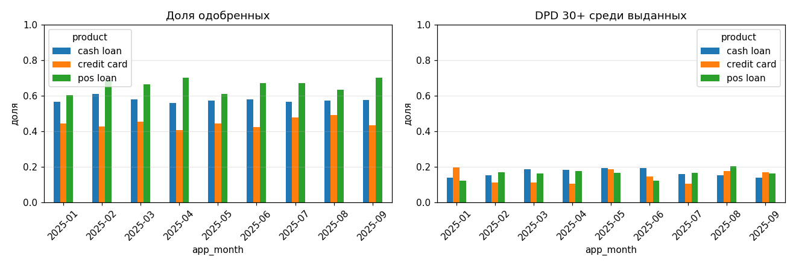

# 📊 Ежемесячный отчёт по кредитным заявкам

Jснова для регулярного отчёта по портфелю розничного кредитования.  
**Автор:** Талалаева Любовь 
**Дата:** Ноябрь 2026

---

## 🎯 Задача

По трём источникам (заявки, выданные кредиты, статусы платежей) собрать витрину на уровне заявки и рассчитать метрики в разрезе **месяц подачи × продукт**: количество заявок, доля одобрения, конверсия «одобрено → выдано», средние суммы, доля кредитов с просрочкой 30+ дней.

---

## 📈 Результат

| Метрика | Значение |
|---|---|
| Всего заявок (уникальных) | **10 000** |
| Одобрено | **5 733 (57.3 %)** |
| Выдано кредитов | **4 360** |
| Конверсия «одобрено → выдано» | **76.0 %** |

Полная таблица — в [`metrics_by_month_product.csv`](metrics_by_month_product.csv).

---

## 🧱 Структура
